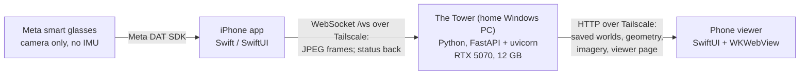

# Glasses

**Walk through a room wearing Meta smart glasses. About 13 to 20 minutes after
you press Stop, your iPhone shows a photographic 3D model of that room that you
can explore.**

This README has two halves. The first half explains the project in plain
language. The second half, from [World Builder in depth](#world-builder-in-depth)
on, is the technical account. Every claim in it is taken from the code and
contracts in this repository, or from dated measurements of real walks.

---

## What it is

Glasses turns an ordinary walk around a room, wearing Meta's camera glasses,
into a 3D, photo-textured model of that room, which you can explore on an
iPhone. The glasses stream what they see to an iPhone app. The app forwards
the stream to a GPU computer at home, called **the Tower**. The Tower works out
where the camera was for every useful picture, rebuilds the room's surfaces,
and paints them with the real photos. All reconstruction, and every model it
uses, runs on the home Tower, not in the cloud.

The Tower can run several "cartridges" (pluggable features) on the same stream:
**World Builder** (3D rooms, the focus of the demo), **Object Memory**
("where did I leave it"), **Document Memory** (pages read and made searchable),
**Scene Understanding** (what is visible right now), and the **CV Lab**
(computer-vision experiments that can be switched at runtime).

### Why it is hard

- **No depth sensor.** The glasses have one ordinary camera, so distance has to
  be inferred from the pictures, by geometry (structure-from-motion) and by a
  neural depth model.
- **No motion sensor.** The glasses' gyroscope is not available to the app
  (a permission on Meta's side), so all tracking is done from the images alone.
- **The camera is on a moving head.** People mostly turn their heads rather
  than step sideways. Turning gives the geometry almost nothing to measure
  (an early measurement found 53.69% of consecutive frame pairs had too little
  parallax to use), and fast turns blur the frames.
- **Reflective rooms.** A mirror-heavy bathroom can come out at the wrong
  size; one historical walk placed a bathroom at 2.56 times the room's scale.
- **The wearer is in the picture.** Hands, arms and the phone being held show
  up in the frames and must not be painted onto the furniture.
- **Privacy.** A camera on someone's face sees other people.

## The demo in one paragraph

Open the iPhone app, go to World Builder, and press **Start**. Walk the room
for two to four minutes while the glasses stream to the Tower. While you walk,
a twelve-segment **capture dial** on the phone fills in, segment by segment,
with real photos of the directions the Tower has confirmed. Press **Stop**. The
Tower runs its final pipeline; the phone says which stage it is in and how long
it has been since Stop, with no fake progress bar. When it finishes, the saved
world opens as a photographic 3D room you can move around in. A
walk of about three and a half minutes (walk 10, the dress rehearsal) took
**13.1 minutes** from Stop to the photographic world on a freshly started Tower.
A previously built world (walk 9.3) is kept as the backup.

## Architecture



Inside the Tower, while the World Builder cartridge is active, one follower
process attaches to each capture and owns child processes for the heavy work, so nothing slow ever runs on the
frame path:

```
 frames ──> /ws ──> capture ──> World Builder follower (one per walk)
                                  │  per frame: track, pick keyframes, persist
                                  │  every 4 keyframes: incremental rebuild
                                  ├─> background global solve (child, CPU)
                                  │      └─ when it "lands" ──> live surface + photos (child, GPU)
                                  └─> on Stop: final solve ─> scale guard ─> surface ─> appearance
```

The transport rule (from [`docs/contracts/TOWER-UNIFIED-CARTRIDGES.md`](docs/contracts/TOWER-UNIFIED-CARTRIDGES.md) §3):
one WebSocket carries frames and small status messages; **bulk data and
imagery never travel on the socket**, because the result sender shares a lock
with the frame path and a large payload would stall frames. Saved worlds,
meshes, photos and the viewer page go over HTTP.

## Repository map

| Path | What lives there |
|---|---|
| [`ios/`](ios/) | The iPhone app (Swift/SwiftUI, Xcode project [`ios/Glasses.xcodeproj`](ios/Glasses.xcodeproj)). World Builder's phone side is [`ios/Glasses/Workspaces/WorldBuilder/`](ios/Glasses/Workspaces/WorldBuilder/). |
| [`tower/`](tower/) | The Tower server (Python 3.12, FastAPI/uvicorn). World Builder is [`tower/tower/world_builder/`](tower/tower/world_builder/); the per-walk follower is [`tower/scripts/world_build_session.py`](tower/scripts/world_build_session.py); every switch is documented in [`tower/tower/config.py`](tower/tower/config.py). Setup and run guide: [`tower/README.md`](tower/README.md). |
| [`docs/contracts/`](docs/contracts/) | The shared protocol truth between phone and Tower: one contract per artifact (geometry, surface, appearance, saved worlds, iOS behaviour, Object Memory, the unified cartridge summary). Tower-owned contracts are in [`tower/docs/contracts/`](tower/docs/contracts/). |
| [`docs/agent-handoffs/`](docs/agent-handoffs/) | Current-state handoff notes between development lanes: status, validation runs, root-cause write-ups. |
| [`CLAUDE.md`](CLAUDE.md) | The rules every AI agent works under: subsystem ownership, lane isolation, filesystem policy. |
| [`.githooks/pre-commit`](.githooks/pre-commit) | The guard that refuses agent commits in the shared checkout. |

---

## World Builder in depth

### During the walk

| Stage | What it does | Key technique | Why it exists |
|---|---|---|---|
| **Per-frame front end** ([`frontend.py`](tower/tower/world_builder/frontend.py)) | Decodes each frame, scores sharpness, tracks features, summarises motion | Shi-Tomasi corners + Lucas-Kanade optical flow; about 5 ms a frame at 360x640 | Cheap enough for every frame. It reads no clock (frame spacing varies) and needs no camera calibration |
| **Keyframe selection** ([`keyframes.py`](tower/tower/world_builder/keyframes.py)) | Decides which frames become permanent observations | Sharpness (variance of the Laplacian), track survival, overlap and displacement against the last keyframe | Most frames carry no new information; the system, not the wearer, decides which earn the expensive path |
| **Turn bridge** (same file, `TOWER_WORLD_KEYFRAME_TURN_BRIDGE`) | During a fast head turn, accepts a slightly blurred frame once the view has turned far enough that waiting for a sharp one would lose the link | Uses the tracker's own overlap (< 0.5, about 20 to 25 degrees of yaw) and displacement numbers; pure smear is still refused | On walk 9 the blur gate rejected every frame inside a turn, so consecutive keyframes ended up 52 to 391 degrees apart with a ~45 degree field of view. All 9 of that walk's breaks sat on such a gap |
| **Incremental SfM rebuild** ([`engine.py`](tower/tower/world_builder/engine.py), [`backends/classical.py`](tower/tower/world_builder/backends/classical.py)) | Grows the map every 4 keyframes by default (`TOWER_WORLD_REBUILD_EVERY`) | Calibrated incremental structure-from-motion: ORB features, essential matrix for the first pair, then PnP against the accumulated 3D points. It extends one live solve instead of re-solving: 6.83 s down to 0.92 s over 64 keyframes | Gives the phone geometry during the walk. A degenerate frame is refused rather than guessed, because a wrong focal length or pose gives confidently wrong geometry |
| **Background global solve** ([`global_solve.py`](tower/tower/world_builder/global_solve.py)) | Every 50 or more new keyframes (when none is running), a child process solves the *whole* walk at once; its result **lands** into the world | SIFT, sequential matching, then GLOMAP (rotation averaging, global positioning, bundle adjustment) as shipped in pycolmap 4.2. The feature database persists per walk, so a re-solve only pays for new keyframes (12 s to match 138 new against 300 old) | The per-segment chain drifts and breaks. On one 438-keyframe walk the chain put 58 keyframes in one frame; the global solve placed 428 of 438 at 0.84 px mean reprojection error. It runs on the CPU (pycolmap has no CUDA build on Windows) |
| **Live depth** ([`live_depth.py`](tower/tower/world_builder/live_depth.py)) | Predicts depth for keyframes as they arrive | MoGe-2 (ViT-L) monocular depth | Saves time after Stop, and is the metric evidence the scale guard reads later |
| **Live surface and photos** (`BackgroundSurface` in [`world_build_session.py`](tower/scripts/world_build_session.py)) | Rebuilds the surface and photos each time a solve lands | A GPU child at below-normal priority, so solving and frame intake win the CPU | Only the global solution is worth meshing; between landings the surface is honestly unchanged |
| **Guidance coverage** ([`guidance_coverage.py`](tower/tower/world_builder/guidance_coverage.py)) | After each landing, works out which of 12 directions each room piece has been seen from, and publishes thumbnails | Station coverage from the landed solve, built on a budgeted worker thread that a status poll never waits on | Feeds the phone's capture dial (see [The phone app](#the-phone-app)) |

### After Stop

1. **Final global solve** (~5 min). The same GLOMAP recipe over every keyframe of
   the walk. With `TOWER_WORLD_FINISH_STAGES` on, the phone names the stage it
   is in (`waiting`, `preparing`, `matching`, `placing`, `checking`, `assembling`).
2. **Final scale guard** ([`final_scale_guard.py`](tower/tower/world_builder/final_scale_guard.py),
   `TOWER_WORLD_FINAL_SCALE_GUARD`). For every camera it compares the solve's
   depth with the depth network's metric depth (`log(z_sfm / z_metric)`). A run
   of cameras is set aside only when it has at least 10 measurements, its median
   ratio is outside [0.8, 1.25], and its 95% bootstrap interval (400 draws,
   fixed seed) excludes 1. Set-aside pieces are kept as separate pieces, never
   drawn at the wrong size inside the room. The guard can only *remove* room
   membership; it never attaches anything.
   *Why:* an evidence gate decides what to attach, but nothing checked the
   result actually published, and a mirror-heavy bathroom was once published at
   2.56 times the room's scale.
3. **Surface** ([`surface_pipeline.py`](tower/tower/world_builder/surface_pipeline.py),
   contract [`WORLD-BUILDER-SURFACE.md`](docs/contracts/WORLD-BUILDER-SURFACE.md)):
   - **Depth.** MoGe-2 depth per keyframe, fitted to the solve's sparse 3D points
     by a robust affine per frame (reused from the live cache where it matches).
   - **Transient masking** ([`transients.py`](tower/tower/world_builder/transients.py)),
     the largest stage, about 5 min. Finds the wearer's hands, arms and held
     phone with Grounding DINO (text prompts "hand. arm. sleeve. mobile phone.")
     plus SAM 2.1 masks, unioned with OneFormer (Swin-L, COCO panoptic). On 62
     hand-labelled frames: 97.7% hand/arm recall, 99.7% held-phone recall, 3.1%
     of static pixels flagged. A phone counts only if it touches a hand, so a
     phone lying on the desk stays in the room. Masked pixels get zero weight in
     fusion and in the photos.
   - **Depth consistency** ([`depth_consistency.py`](tower/tower/world_builder/depth_consistency.py)).
     Each frame's depth is smooth, but frames disagree with each other about
     where a wall is by 6 to 12 voxels, which crumples walls. A smooth
     per-frame correction (cubic B-splines, 108 numbers a frame) is solved
     jointly with LBFGS against the sparse points and the other frames, and
     applied only when held-out data says it helps.
   - **TSDF fusion** ([`surface.py`](tower/tower/world_builder/surface.py)).
     A sparse truncated signed distance field over 8³-voxel blocks on the GPU.
     Free space is evidence too (a camera that measures a wall at some depth
     has also measured that the space in front of it is empty), which removes
     floaters and things that moved. The field has a **block budget** of 360,000 blocks (~3.4 GiB, sized
     to fit a 12 GB card); a bigger scene gets a coarser voxel, chosen up front,
     instead of running out of memory.
   - **Marching cubes** meshing, then component pruning and feature-preserving
     smoothing. Holes are deliberately not closed: space no camera measured
     emits no triangle (unlike Poisson reconstruction, which is watertight by
     construction).
   - **Plane snap.** Large, well-measured planes (seen by at least 8 keyframes,
     fit RMS at most 2.5 voxels) have nearby vertices moved onto the plane,
     along its normal only. It adds and removes nothing.
   - **LOD pack.** A level-of-detail ladder; the phone gets level 2, the largest
     decimation that fits a **6 MiB** page (about 238k faces).
4. **Photographic appearance** ([`appearance_pipeline.py`](tower/tower/world_builder/appearance_pipeline.py),
   contract [`WORLD-BUILDER-APPEARANCE.md`](docs/contracts/WORLD-BUILDER-APPEARANCE.md)).
   The keyframes themselves, undistorted, with alpha 0 wherever a pixel is not
   appearance (a redaction fill, a hand, the phone), a per-channel exposure
   gain, and the level-2 mesh as a proxy. The phone blends the keyframes that
   saw each point, view-dependently (unstructured-lumigraph style). The Tower
   prepares; the phone renders.

### Timing

Measured on 2026-10-13 on the RTX 5070 Tower:

| Walk | Tower state | Stop to photographic world |
|---|---|---|
| 4 min | freshly started | **19.1 min** (measured) |
| 4 min | long-running process | 28.7 min (measured) |
| 3 min 22 s (walk 10) | freshly started | **13.1 min** (measured: final solve +3.6, surface +11.1, photos +13.1) |

| Stage after Stop (4-min walk) | Time |
|---|---|
| Final global solve | ~5 min |
| Transient masking (hands, phone) | ~5 min |
| Everything else (scale guard, depth, consistency, fusion, meshing, pack, appearance) | the remaining ~9 min (derived, not separately measured here) |

Per-stage timing can be recorded with `TOWER_WORLD_STAGE_TIMING`
([`tower/docs/world-builder-stage-timing.md`](tower/docs/world-builder-stage-timing.md)).

### Quality: walk 9.3, the demo's backup world

- 942 of 1,212 keyframes placed by the final solve, almost all of them in one
  connected room piece. Five small pieces were set aside by the scale guard.
  Their frames show why: three were motion blur in dim spots, one was a
  close-up of a near-blank wall corner, and one was the mirror-and-porcelain
  bathroom.
- Coverage: in 360° turnaround renders from four spots in the room, 95 to 100%
  of every view is filled with surface, including the views facing away from
  the direction of walking.

---

## The phone app

- **Capture.** The app receives camera frames from the glasses through Meta's
  Wearables Device Access Toolkit (the `MWDATCore` / `MWDATCamera` frameworks)
  and forwards them as JPEG frames over one WebSocket, at a 12 fps target
  (`IOS_TOWER_TARGET_FPS`, allowed 6 to 24). A bounded send window admits a
  frame only while a send slot is free, so a slow link drops frames instead of
  building a backlog. The Tower address is configurable in Settings, with a
  read-only connection test.
- **One cartridge at a time.** Opening the World Builder workspace tells the
  Tower to start a World Builder session; leaving it stops the session. A
  builder attaches to a capture only while that session is active.
- **The capture dial** ([`WorldCaptureDial.swift`](ios/Glasses/Workspaces/WorldBuilder/WorldCaptureDial.swift),
  `IOS_FOW_DIAL`). A ring of twelve directions for the current room piece,
  like a clock face. The top is fixed: it is the way the wearer faced when the
  walk started, captioned "start", and the ring never rotates. A segment fills
  when the Tower's landed solves have confirmed that direction with two or more
  views (one view shows as weak), and filled segments show the room's own
  photos. The largest gap is outlined in amber. A one-line footer reads
  "N of 12 directions · updated N s ago", and a "Recently captured" strip shows
  the last few photos (tap to enlarge). There is no hint text and no arrow: it
  is a pure visual aid ("I haven't seen my 8 o'clock yet"). It never claims the
  room is complete, never says where the wearer is, and is never a compass.
- **Capture health.** Operator rows during a walk: Tower link, keyframes per
  minute, tracking breaks in the last 30 s, the look-back relocalizer, and how
  far the map is behind. A missing or stale figure shows as "—", never as live.
- **After Stop.** A stage word (when the Tower reports one), the elapsed time
  on the phone's own clock, and a PREVIEW label on any picture of an unfinished
  world. No percentage and no estimate. A viewer opened after Stop still gets
  the walk's photos while the final build runs.
- **Saved worlds** ([`WorldLibrary.swift`](ios/Glasses/Workspaces/WorldBuilder/WorldLibrary.swift)).
  `GET /worlds` lists every stored world; the picker opens any of them.
- **The viewer** ([`WorldRenderViewer.swift`](ios/Glasses/Workspaces/WorldBuilder/WorldRenderViewer.swift),
  [`WorldAssetTransport.swift`](ios/Glasses/Workspaces/WorldBuilder/WorldAssetTransport.swift),
  [`WorldChromeOverlay.swift`](ios/Glasses/Workspaces/WorldBuilder/WorldChromeOverlay.swift)).
  The Tower serves the best representation the world has, down a ladder:
  appearance, then surface, then dense points, then sparse points. The
  photographic page (WebGL, served by the Tower) runs in a `WKWebView` that
  loads only through a private `glasses-world:` URL scheme; a native handler
  proxies a short whitelist of that world's Tower routes and nothing else, and
  the page's Content-Security-Policy says the same from its side. With native
  chrome on (`TOWER_WORLD_NATIVE_CHROME`), the controls around the 3D view are
  drawn in SwiftUI rather than HTML. The coverage map and the fragment view
  are drawn natively with SwiftUI `Canvas` (the fragment view pans, pinches
  and rotates).

## Privacy and safety

- **Local only.** Frames go from the phone to the home Tower over a private
  Tailscale network. Reconstruction and every model (depth, segmentation, face
  detection) run on the home GPU.
- **Face redaction before anything is saved**
  ([`redaction.py`](tower/tower/world_builder/redaction.py)). The YuNet face
  detector runs at the single point every stored pixel passes through, and
  faces are filled with solid black (not blurred: blur is partly reversible).
  Redacting on the way *out* would leave raw faces on disk, so it happens on
  the way *in*.
- **Honest labels.** Every stored keyframe set records how it was redacted, and
  imagery that was not redacted is labelled `"unredacted"` wherever it is served.
- **The demo walks are redacted.** Walk 9.3 (the demo's backup world) and
  walk 10 (the dress rehearsal) both record
  `faces-detected-and-filled/yunet-2023mar@0.30+plausibility3`.
  - For a period around 2026-09-21 the owner temporarily bypassed the
    redactor, so reconstruction quality could be judged on its own
    ([`WORLD-BUILDER-PHOTOGRAPHIC-FIXIT.md`](docs/agent-handoffs/WORLD-BUILDER-PHOTOGRAPHIC-FIXIT.md) §7).
    Walks from that period are labelled `redaction: "none"`. The phone only
    shows their photos when `TOWER_WORLD_GUIDANCE_IMAGERY_UNREDACTED` is on,
    and then marks them `"unredacted"`.
  - There is a known limit: a face redacted in one frame can still appear in
    another frame that saw the same surface. A cross-frame redaction consensus
    is the designed fix. Worlds should be reviewed before being shared outside
    the home.
- **The wearer is removed too.** Transient masking keeps the wearer's hands and
  phone out of the geometry and the photos.

---

## Engineering practices

- **Tests.** The Tower suite has **7,119 passing tests** (Windows, 2026-10-13).
  Golden-file tests pin "switch off" behaviour byte for byte against a named
  commit (for example `test_world_builder_solve_select_off_identity.py`).
- **Contracts first.** Phone and Tower agree through written contracts in
  [`docs/contracts/`](docs/contracts/), each with an opaque identifier a client
  compares for equality. The artifact contracts (surface, appearance) state
  what an artifact claims and what it promises never to claim.
- **Every behaviour change behind a default-off switch.** Each new behaviour
  gets its own environment switch, off by default; most accept only the exact
  value `on`, and off means the previous behaviour byte for byte. Changes are
  A/B-tested by replaying recorded walks on a separate test Tower before they
  reach the demo Tower.
- **Automated visual QA.** Every built world gets a **RENDER-PACK**: turnaround
  renders from 4 stations by 8 directions, which a vision-capable AI reviewer
  grades for orientation, placement, missing areas and regressions before a
  human looks. The tooling is campaign tooling and is not on `main`.
- **Refuse rather than guess.** Throughout the code a stage that cannot measure
  something says so (a refused pose, an `uncertified` scale, a "—" on the phone)
  instead of inventing a plausible answer.
- **Multi-agent development.** A Claude "manager" on the Mac coordinates a
  headless Claude "lead" running on the Windows Tower through a file mailbox,
  plus Claude subagents and OpenAI Codex as reviewers and implementers.
  - Each agent works in its **own git worktree** (lane isolation). A
    [pre-commit hook](.githooks/pre-commit) refuses agent commits in the shared
    canonical checkout, after two agents once collided in one working tree
    (rules in [`CLAUDE.md`](CLAUDE.md)).
  - A **graphify knowledge graph** of the codebase (about 31k nodes, served
    over MCP) is queried before reading files, to cut exploration tokens.
- **Evidence over hunches.** On 2026-10-13 a candidate build with three new
  features tested *worse* on two recorded-walk replays, so it was shelved. The
  demo runs the proven build.

## Hard problems and what was learned

- **Fast head turns broke tracking.** The blur gate threw away every frame
  inside a turn, leaving gaps far wider than the camera's ~45 degree view. Fix:
  the turn bridge ("a weak link beats a broken chain"), a written capture
  technique (step while turning, turn in stages, walk through doorways), and the
  dial, which shows which directions are still missing.
- **Segments that would not glue together.** Gluing separately drifted
  segments with a similarity transform failed because the segments were not
  rigid. Fix: a global solve over every keyframe (58 to 428 of 438 keyframes in
  one frame).
- **Reflective bathrooms.** Mirrors gave a piece of the walk the wrong metric
  scale, and it was published inside the room at 2.56 times. Fix: the final
  scale guard, which checks the actual published result and sets such pieces
  aside.
- **Far-depth spray and GPU memory.** Depth beyond a frame's farthest fitted
  point is extrapolation, so it is cut at 1.5 times that distance per frame
  (an earlier global clip deleted 9% of valid depth, including the far wall).
  Fusion is confined to a box built from what was observed. Block count tracks
  surface area seen (a tight bathroom made 380k blocks from 132 frames), so a
  fixed block budget coarsens the voxel instead of running out of memory.
- **Starving the frame path.** Bulk data on the WebSocket would hold the lock
  the frame path needs (a 1.07 MB geometry file against a 3.9 KB status), so
  bulk goes over HTTP from FastAPI's threadpool. Background photo work is
  budgeted on thread CPU time, after a loaded Tower starved it and the phone
  showed "Photos unavailable".
- **Orphaned child processes.** A builder once died with a solve in flight and
  the orphan ran on for 32 s. Every child is now owned, and the builder's
  cleanup leaves nothing behind.
- **A slow long-running Tower.** The same 4-minute walk took 28.7 min on a
  long-running Tower against 19.1 min on a fresh one. On the long-running one,
  frame intake fell behind during the walk (3.4 min of backlog after Stop), and
  every later stage ran slower. The demo procedure restarts the Tower fresh
  before walking. The root cause (a long-lived process carrying several walks'
  background workers) is inferred from timing and not yet profiled.

## Running it

- **Which code.** On the Mac and the Tower the shared checkout (`Projects/Glasses`)
  is on `main`. The demo baseline is the tag `demo-walk10-20261013`, the code
  walk 10 was built with; later commits on `main` change documentation only.
  New work happens in worktrees under `Projects/Glasses-worktrees/`, never in
  the shared checkout.
- **Tower (Windows):** see [`tower/README.md`](tower/README.md). In short, from
  `tower/`: `powershell -NoProfile -File scripts\setup_tower.ps1` once, then
  `powershell -NoProfile -File scripts\start_tower.ps1` each time. Setup
  writes `tower/.env` with `TOWER_CAPTURE_ROOT=data` (without it nothing is
  ever recorded) and `TOWER_WORLD_ROOT=data/world_builder` (without it World
  Builder is reported as unsupported). The Tower is up when
  `http://<tower>:8000/health` answers `"status": "ok"`. Tests:
  `.venv\Scripts\python.exe -m pytest`.
- **The demo configuration.** There is no single "demo mode". Every new
  behaviour ships behind its own default-off switch, so `start_tower.ps1` with a
  basic `.env` (just the capture and world roots) runs with all of them off.
  The demo is these switches, written as lines in the Tower's `tower/.env`
  (gitignored, so they live on that machine, not in the repository). With them
  there, a plain `start_tower.ps1` starts the demo; delete them to go back.
  Each is documented in [`tower/tower/config.py`](tower/tower/config.py):

  | Switch | What it turns on |
  |---|---|
  | `TOWER_WORLD_KEYFRAME_TURN_BRIDGE=on` | Keyframes through fast head turns (the turn bridge) |
  | `TOWER_WORLD_UP_ESTIMATE=camera_right_all` | How "up" is estimated for the room |
  | `TOWER_WORLD_LIVE_DEPTH=on` | Depth predicted during the walk |
  | `TOWER_WORLD_FINAL_SCALE_GUARD=on` | The final scale guard |
  | `TOWER_WORLD_TRANSIENTS_FP16=on` | Half-precision transient masking (faster) |
  | `TOWER_WORLD_GUIDANCE_COVERAGE=on`, `..._COVERAGE_PENDING=on` | The capture dial's coverage |
  | `TOWER_WORLD_GUIDANCE_IMAGERY_LIVE=on`, `..._IMAGERY_LANDED=on`, `..._IMAGERY_UNREDACTED=on` | The dial's photos |
  | `TOWER_WORLD_PHOTO_FLOORPLAN=on` (`..._METHOD=homography`, `..._DIAGNOSTICS=on`) | The photo floor plan (hidden on the phone in the demo build) |
  | `TOWER_WORLD_NATIVE_CHROME=1` | Viewer controls drawn in SwiftUI |

  Before a demo, start the Tower **fresh**. A long-running process was measured
  ~1.5× slower after Stop.
- **iPhone app (Mac):** open [`ios/Glasses.xcodeproj`](ios/Glasses.xcodeproj)
  in Xcode, run on a device paired with the glasses, and set the Tower's
  address in Settings.
- **A walk:** on the phone, open World Builder, press Start, walk, press Stop.
  The Tower attaches a builder to the capture by itself.
- **Saved worlds.** Every world lives on the Tower in
  `tower/data/world_builder/worlds/<world id>/` (the mesh under `surface/`, the
  photos under `appearance/`, in the Tower's own binary formats, so they open
  only through the Tower). The phone lists them under Saved worlds. To view
  one in a desktop browser while the Tower runs, open
  `http://<tower>:8000/worlds/<world id>/render?transport=tower`; without
  `transport=tower` the photographic page fetches its photos through the
  phone app's private channel, which a browser cannot open, so no photos load.

## Glossary

| Term | Meaning |
|---|---|
| **Keyframe** | A frame the system keeps permanently because it adds new information; most frames are discarded. |
| **SfM** | Structure-from-motion: recovering camera positions and 3D points from overlapping 2D images. |
| **GLOMAP** | A global SfM method (rotation averaging, then global positioning, then bundle adjustment) that solves all cameras at once instead of one by one; used here through pycolmap. |
| **Landing** | The moment a background global solve finishes and its result replaces the world's geometry. |
| **Piece / component** | A set of keyframes solved into one shared coordinate frame. The room is the main piece; pieces that disagree are set aside, not merged. |
| **TSDF** | Truncated signed distance field: for each small cell of space, how far it is to the nearest surface and how much evidence supports that. The surface is where the distance crosses zero. |
| **Voxel block** | A cube of 8x8x8 voxels; the TSDF allocates space only in blocks near observed surfaces. |
| **LOD** | Level of detail: the same mesh at several decimations; the phone gets the largest one that fits 6 MiB. |
| **Transient** | Something in a frame that is not part of the room: the wearer's hands, arms, or held phone. |
| **Appearance** | The photographic layer: the real keyframes projected onto the mesh and blended by viewing direction. |
| **Cartridge** | A pluggable Tower feature with its own contract (World Builder, Object Memory, Document Memory, Scene Understanding, CV Lab). |
| **Env switch** | An environment variable that turns one behaviour change on; off by default, and off means the old behaviour exactly. |
| **Lane / worktree** | One agent's line of work, done in its own git worktree on its own branch, never in the shared checkout. |
| **RENDER-PACK** | The automated set of turnaround renders (4 stations x 8 directions) made for every built world and graded by an AI reviewer before a human looks. |
